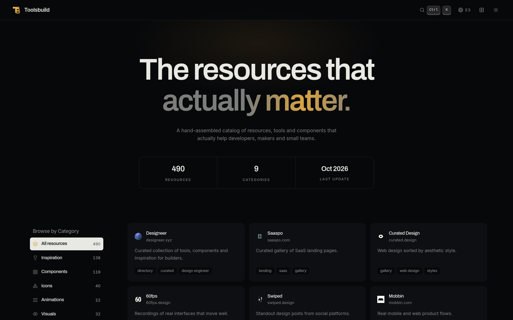

# Toolsbuild

## Description

Toolsbuild is a hand-curated directory of **506 resources for designers, developers and small teams**, organized into **10 categories**: inspiration galleries, UI components, icon sets, animation references, visual assets, build tools, MCP servers, learning material, and everyday utilities.

Every entry includes a favicon, tags, and a short description in **Spanish and English**, so you can scan the catalog, filter by category, and jump straight to the resource. The site is fully static, dark-first, responsive, and ships with:

- Full-text **search** over names, descriptions and tags — press `Ctrl` / `⌘ + K`
- **Category sidebar** with live counts
- **Grid and list views** with a layout toggle
- Bilingual UI — Spanish at `/`, English at `/en`
- "New" badges on resources added in the last 14 days

Built with [Astro](https://astro.build), React and Tailwind CSS.

## Screenshots



## Getting Started

### Installing

```sh
git clone https://github.com/DylanZM/ToolsBuild.git
cd ToolsBuild
npm install
```

### Execute
```sh
npm run dev
```

## License

No license has been specified for this project yet.
