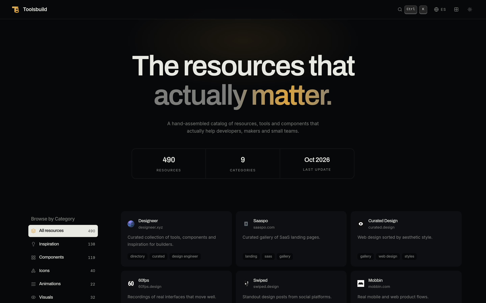

# Toolsbuild

## Description

Toolsbuild is a hand-curated directory of **526 resources for designers, developers and small teams**, organized into **10 categories**: inspiration galleries, UI components, icon sets, animation references, visual assets, build tools, MCP servers, learning material, and everyday utilities.


## Screenshots



## Getting Started

### Installing

```sh
git clone https://github.com/DylanZM/ToolsBuild.git
cd ToolsBuild
npm install
```

### Execute
```sh
npm run dev
```
Starts the local dev server at `localhost:4321`.

## License

No license has been specified for this project yet.
